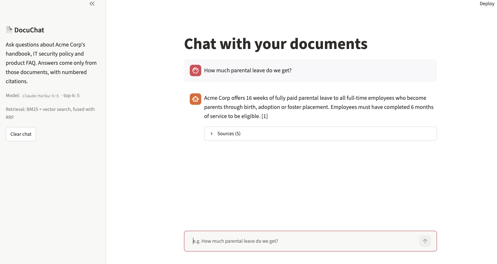
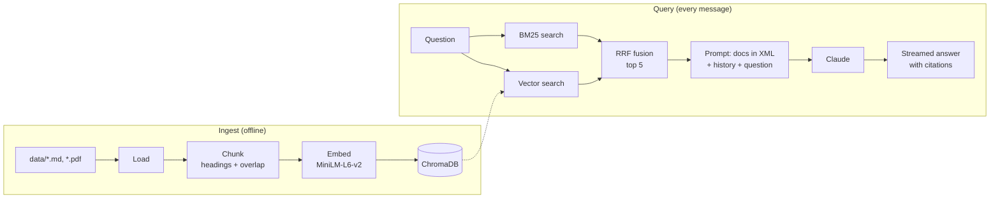

# DocuChat 📄💬


A retrieval-augmented generation (RAG) chatbot that answers questions about a company's
documents **with numbered source citations**, built from scratch in Python with
**hybrid search (BM25 + vectors)**, Claude, ChromaDB and Streamlit, and an evaluation
harness that measures **Recall@K and MRR**.



## Features

- **Structure-aware chunking**: Markdown is split on headings first, then recursively
  (paragraph, line, sentence, word) with overlap. Each chunk carries its heading path,
  e.g. `Employee Handbook > Leave and Time Off > Parental Leave`.
- **Hybrid retrieval**: BM25 keyword search catches exact terms such as `EXP-310` or
  `CD-1042`; vector search catches paraphrases ("time off after having a baby").
  The two rankings are merged with **Reciprocal Rank Fusion**.
- **Grounded answers**: the model may only use the retrieved documents, must cite them
  as `[1]`, `[2]`, and says "I couldn't find that in the documents." instead of guessing.
- **Streaming multi-turn chat** with history trimming to keep the context window small.
- **Evaluation**: `make eval` compares vector, keyword and hybrid retrieval on a labeled
  question set.
- **Tested**: 24 unit tests run offline (fake embedder, fake LLM) in GitHub Actions.

## Architecture



## Quickstart

```bash
git clone https://github.com/Arjunsilwal/docuchat.git
cd docuchat
python -m venv .venv && source .venv/bin/activate   # Windows: .venv\Scripts\activate
pip install -r requirements-dev.txt

cp .env.example .env        # then paste your Anthropic API key into .env

python -m ragbot.ingest     # build the vector index from data/
streamlit run app.py        # open http://localhost:8501
```

Add your own documents by dropping `.md`, `.txt` or `.pdf` files into `data/` and
running the ingest step again.

## Evaluation

`eval/questions.jsonl` holds 20 labeled questions. A chunk counts as relevant when it comes
from the labeled source file and contains the labeled answer text, so the labels stay valid
when the chunk size changes.

```bash
python -m ragbot.evaluate --k 5
```

| Mode | Recall@5 | Precision@5 | Hit@5 | MRR |
|---|---|---|---|---|
| vector | 1.00 | 0.20 | 1.00 | 0.94 |
| keyword | 0.90 | 0.18 | 0.90 | 0.85 |
| hybrid | 1.00 | 0.20 | 1.00 | 0.88 |


## Design decisions

| Decision | Why |
|---|---|
| No LangChain | Writing chunking, fusion and evaluation by hand shows how RAG works; the modules map 1:1 onto LangChain or LlamaIndex components if needed. |
| Hybrid search + RRF | Embeddings blur exact identifiers; BM25 misses paraphrases. RRF merges by rank, so different score scales do not matter. |
| Local embeddings | `all-MiniLM-L6-v2` (384 dims) is free, fast and private; no second API key. |
| Documents first, question last, in XML tags | Clear separation of data and instructions; also reduces prompt injection from document text. |
| History without old documents | Only plain Q&A is resent, so each turn spends its tokens on freshly retrieved evidence. |
| `claude-haiku-5-5` default | Answering from provided context is an easy task; the small tier keeps cost to cents. Change `CLAUDE_MODEL` to try larger models. |

## Project structure

```
ragbot/
  config.py      settings (env-overridable)
  loaders.py     read .md / .txt / .pdf
  chunking.py    structure-aware + recursive chunking with overlap
  store.py       ChromaDB vector store + embeddings
  ingest.py      CLI: load -> chunk -> embed -> store
  retriever.py   BM25 + vector search + Reciprocal Rank Fusion
  prompts.py     system prompt, XML context, history trimming
  llm.py         Claude Messages API (streaming)
  pipeline.py    retrieve -> prompt -> generate
  metrics.py     Recall@K, Precision@K, Hit@K, MRR
  evaluate.py    CLI: compare retrieval modes on eval/questions.jsonl
app.py           Streamlit chat UI
tests/           pytest suite (offline)
```

## Roadmap

- Cross-encoder re-ranking of the top 20 candidates
- Query rewriting for follow-up questions ("what about contractors?")
- Answer faithfulness evaluation with an LLM judge
- Docker image and a hosted demo

## License

MIT. The documents in `data/` describe a fictional company and are for demonstration only.